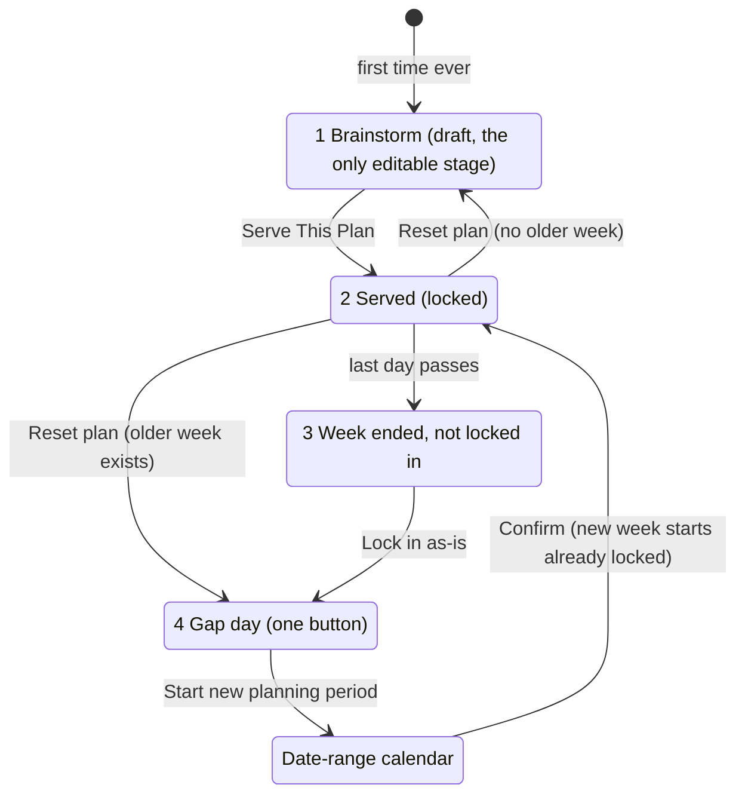

# Prep Table lockout investigation — 2026-11-01

**Why:** Matt's wife stopped using the app in June after getting locked out of planning. Nobody
remembered the exact steps, so instead of trusting memory we mapped the flow from the code and
drove the real UI through every path with Playwright.

**How:** `e2e/lockout-explorer.spec.js` runs the app against a stateful in-memory fake of
Supabase (`e2e/support/fakeSupabase.js`), which remembers writes across reloads and enforces the
no-overlapping-weeks rule. Each scenario steps through simulated days and, at every step, asks
"can she plan the date she wants from here?" Results: `e2e-results/lockout/*.json` plus a
screenshot per step. Rerun with:

    npx playwright test e2e/lockout-explorer.spec.js --reporter=line

**Limits:** a fake database (not Supabase); AI suggestions off; 6 paths, not every permutation;
a desktop viewport, not a phone.

## The flow today

After week one, nothing leads back to Brainstorm.

## Findings (all observed in the test run)

1. **Can't plan next week until this one is over and locked in** (scenario A). Served Sun–Thu;
   on Sun, Wed and Thu there was no control to plan other dates. On Friday: "lock in last week first."
2. **Planning ahead locks out the rest of this week** (scenario B). On Wednesday she served next
   week from the strip; Thu–Sat of this week then couldn't be planned until next week ended.
   The only escape is "Reset this plan", which deletes next week's plan.
3. **The suggested-week view is unreachable after week one** (scenarios A, C, D). Every week
   started via "Start new planning period" begins locked: no date strip, Regenerate disabled,
   only "+" one day at a time.
4. **"Lock in as-is" moves the whole week forward and erases it** (scenario A). With nothing
   marked cooked, every meal counts as a leftover and the leftover picker pre-selects all of
   them. Week 1 ended with 0 meals in its history; week 2 was an exact copy of week 1.
   Production's plan history shows weeks with 0–3 meals each, consistent with this (inferred,
   not traced row by row).
5. **Minor:** the calendar refuses any range touching last week (correct rule, terse message,
   scenario E); "Reset this plan" doesn't appear right after serving until a reload
   (scenarios A, B); returning after weeks away forces a "lock in the old week" step first (scenario D).

No crashes or error screens on any path; the fake database logged no unsupported queries.

## What this feeds

The shared-household spec (`docs/prds/`, in progress) treats findings 1–4 as problems to
solve. Direction under discussion: Serve becomes a checkpoint ("Confirm the week"), nothing
locks, every meal is its own row from the first tap, and uncooked meals never silently move
or vanish from history. Rerun this explorer after that work; findings 1–4 should no longer
reproduce.
